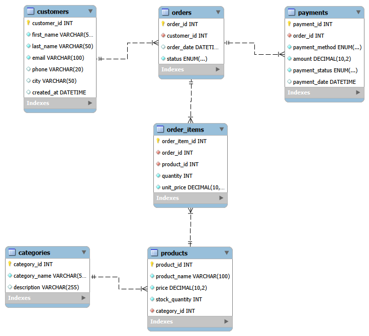

# Table Relationships

## Overview
The database has six tables. `customers` and `categories` are the top-level
(parent) tables. `products` depends on `categories`, `orders` depends on
`customers`, and `order_items` and `payments` depend on `orders`.

## Relationships
- **customers → orders (One-to-Many):** one customer can place many orders,
  but each order belongs to exactly one customer.
- **categories → products (One-to-Many):** one category has many products,
  but each product belongs to exactly one category.
- **orders → order_items (One-to-Many):** one order has many items.
- **products → order_items (One-to-Many):** one product can appear in many
  order items across different orders.
- **orders → payments (One-to-Many):** one order has a payment record.
  The schema allows more than one row per order, so a failed payment can be
  followed by a new attempt.
- **orders ↔ products (Many-to-Many):** one order can contain many products
  and one product can be in many orders. This is resolved through the
  `order_items` junction table.

## Foreign keys
| Child table | Column | References |
|---|---|---|
| products | category_id | categories(category_id) |
| orders | customer_id | customers(customer_id) |
| order_items | order_id | orders(order_id) |
| order_items | product_id | products(product_id) |
| payments | order_id | orders(order_id) |

## Design decisions
- **Why `order_items` is a separate table:** an order can contain many
  products, and a product can appear in many orders. A relational table cannot
  store a list in one column, so a separate table holds one row per product in
  an order. This also keeps `quantity` and `unit_price` next to the right
  order and product.
- **Why `unit_price` is stored in `order_items`:** product prices change over
  time. If an order only pointed to `products.price`, changing a price today
  would silently change the total of every old order. Copying the price at
  purchase time keeps historical orders and revenue reports correct.
- **Why phone is VARCHAR, not INT:** a phone number is an identifier, not a
  number to calculate with. An INT would drop the leading 0 (01711... becomes
  1711...) and could not store symbols such as +880.
- **Why prices use DECIMAL, not FLOAT:** DECIMAL stores exact values, so money
  calculations have no rounding errors.
- **Why status columns use ENUM:** the column can only hold the listed values
  (for example pending, shipped, delivered, cancelled), which blocks typos
  such as "delivred".
- **Why foreign keys are used:** they stop invalid data, such as an order for
  a customer that does not exist, and they prevent deleting a customer who
  still has orders.