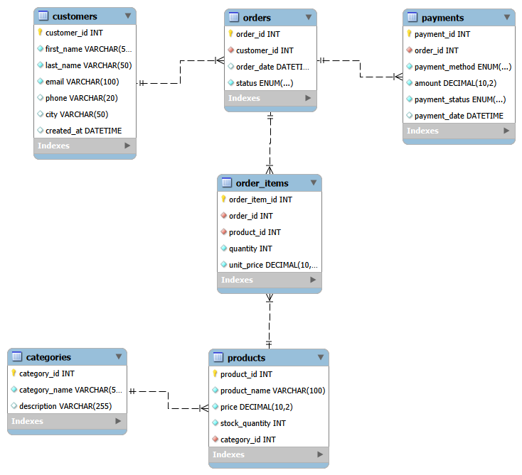

# MySQL E-commerce Database

A beginner-friendly MySQL project that models an online store: customers, products, orders and payments. I am building it step by step while learning SQL, from basic queries to advanced topics.

## Database Schema



The database has six tables: `customers`, `categories`, `products`, `orders`, `order_items` and `payments`.
See [relationships.md](02_database_design/relationships.md) for the relationships and design decisions, and [data_dictionary.md](02_database_design/data_dictionary.md) for every table and column.

## Tools
- MySQL 8.0
- MySQL Workbench 8.0 CE
- Git and GitHub

## How to run
Run the files in this order (MySQL Workbench: `File > Open SQL Script`, then `Ctrl + Shift + Enter`):

1. `01_database_setup/01_create_database.sql`
2. `01_database_setup/02_create_tables.sql`
3. `03_sample_data/01_insert_data.sql`
4. Any file in `04_basic_queries/`

Both setup scripts are safe to re-run. They drop the old objects first, so all existing data is deleted.

## Sample data
| Table | Rows |
|---|---|
| customers | 10 |
| categories | 5 |
| products | 12 |
| orders | 14 |
| order_items | 21 |
| payments | 14 |

The data includes two customers with no orders, a cancelled order, a failed payment and an out-of-stock product, so later queries (such as LEFT JOIN) have realistic cases to work with.

## What I have practiced so far
- **Database design:** primary keys, foreign keys, UNIQUE, NOT NULL, CHECK, DEFAULT, ENUM, a many-to-many junction table (`order_items`)
- **Basic queries:** SELECT, WHERE, AND/OR, IN, BETWEEN, LIKE, ORDER BY, LIMIT, DISTINCT
- **Documentation:** ER diagram, data dictionary, relationship notes

## Project structure
```
MySQL-Ecommerce-Database/
├── 01_database_setup/        create database and tables
├── 02_database_design/       ER diagram, data dictionary, relationships
├── 03_sample_data/           sample data for all tables
├── 04_basic_queries/         SELECT, filter, sort
├── 05_intermediate_queries/  (coming soon)
├── 06_advanced_queries/      (coming soon)
├── 07_transactions_programmability/  (coming soon)
├── 08_business_analysis/     (coming soon)
├── 09_practice_problems/     (coming soon)
└── docs/query_results/       (coming soon)
```

## Roadmap
- [x] Project structure
- [x] Create database and tables
- [x] Sample data
- [x] Database design (ER diagram, data dictionary, relationships)
- [x] Basic queries: SELECT, WHERE, ORDER BY
- [ ] Basic queries: INSERT, UPDATE, DELETE
- [ ] Aggregations and joins
- [ ] Subqueries, CTEs, window functions
- [ ] Transactions, procedures, triggers
- [ ] Business analysis
- [ ] Practice problems

## License
This project is licensed under the MIT License. See [LICENSE](LICENSE).